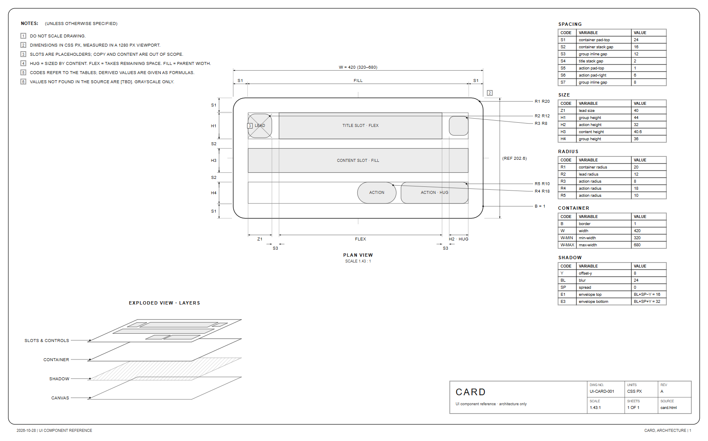
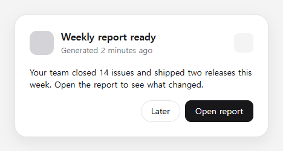
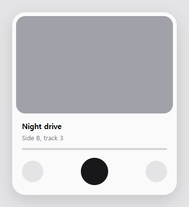
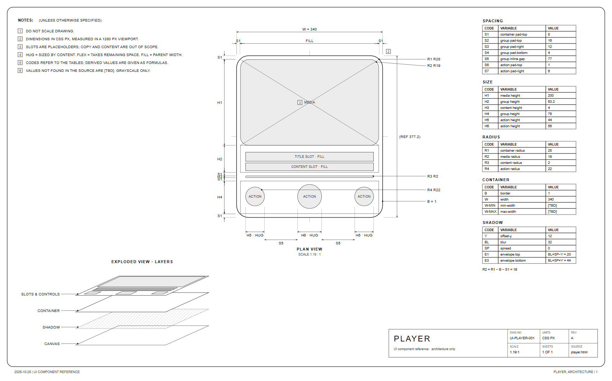
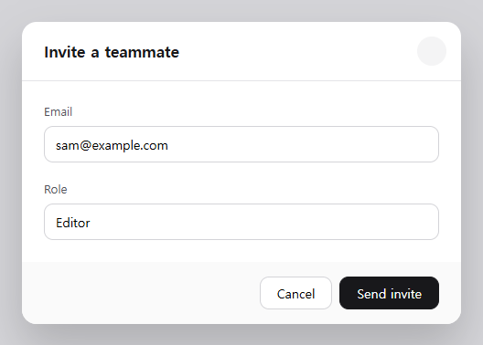
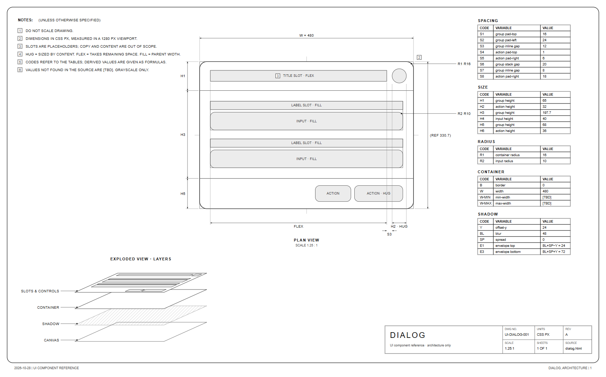

<div align="center">

# dimsheet

**Turn any web component into an Apple-style dimensional drawing, measured from the real page, that draws itself.**

[dimensional-drawing](https://github.com/enesozturk/dimensional-drawing) teaches an agent to hand-draw spec sheets like Apple's accessory drawings. dimsheet measures the component in your browser and draws the sheet in one command, so every number on it is real.

Works with **Claude Code** and **Codex**.

 



<sub>Real output of <code>python dimsheet.py examples/card.html --png -o docs/card</code>. The self-drawing version is <a href="docs/card/sheet-motion.svg">docs/card/sheet-motion.svg</a>.</sub>

</div>

## Quick start
```bash
git clone https://github.com/Dodai0419/dimsheet && cd dimsheet
python dimsheet.py examples/card.html --png -o out
```
```
dimsheet: Card: 420 x 202.6 px, 17 variables -> out\sheet.svg, out\sheet-motion.svg
```
You get `out/sheet.svg` (the drawing), `out/sheet-motion.svg` (the same drawing drawing itself in a 10 s loop), `out/measure.json` (every box it measured) and, with `--png`, `out/sheet.png` plus `out/component.png` (a screenshot of the real component, for a side-by-side check).

Your own page or a live site:
```bash
python dimsheet.py src/Settings.html --select ".dialog" -o out
python dimsheet.py http://localhost:3000/pricing --select "[data-plan=pro]" --width 1440 -o out
```
One Python file, standard library only. Measuring uses the Chrome or Edge already on your machine (its own throwaway profile, never your browser's); redrawing from `measure.json` needs no browser at all.

## Gallery
Left: the real component (`component.png`). Right: what dimsheet drew from it (`sheet.png`).

**Card** (`examples/card.html`): lead + flexible title + close button, a body slot, a footer with a pill and a primary button.

 

**Music player** (`examples/player.html`): an inset cover with a nested corner. dimsheet finds the relation and writes it as a formula: `R2 = R1 − B − S1 = 19`.

 

**Dialog** (`examples/dialog.html`): header, two labelled inputs, an action bar. No min/max width in the CSS, so the table says `[TBD]` instead of guessing.

 

Self-drawing loops (open them in a browser, or put them in a README with ``): [card](docs/card/sheet-motion.svg) · [player](docs/player/sheet-motion.svg) · [dialog](docs/dialog/sheet-motion.svg).

## The problem
- A spec sheet drawn by an agent from reading the code can be wrong: the agent has to guess what a `gap`, a `flex: 1` or an inherited padding becomes on screen.
- Every sheet is hand-written again: dimensional-drawing's example sheets are 260 and 293 lines of HTML each, written by the agent for one component.
- The animated version needs Node, Playwright, a Chromium download and ffmpeg, and comes out as a 7-10 MB GIF or MP4.

## The solution
| Idea | Fixes |
|------|-------|
| **Measure, then draw** (`getBoundingClientRect` + `getComputedStyle` on the rendered page) | Every number on the sheet is what the browser laid out. Anything the CSS does not say (min/max width) is `[TBD]` |
| **One code per value** (S# spacing, H# heights, Z# squares, R# radii, B, W, shadow Y/BL/SP with envelopes E1/E3) | The drawing shows codes, the tables give values, like dimensional-drawing's house rule 3 |
| **Slots, not copy** (LEAD, TITLE SLOT, CONTENT SLOT, ACTION, INPUT, MEDIA with HUG / FLEX / FILL) | The sheet stays true when the text changes |
| **A self-drawing SVG** (one timeline, phases in drawing order, seamless loop, still frame for reduced motion) | The motion version is a ~30 KB file that plays in any browser or README, no video tools |

## Use with Claude Code
```bash
/plugin marketplace add Dodai0419/dimsheet
/plugin install dimsheet@dimsheet
```
Then ask: *"Make a dimensional drawing of the `.pricing-card` on http://localhost:3000"*.

## Use with Codex (ChatGPT)
```bash
git clone https://github.com/Dodai0419/dimsheet && cp -r dimsheet/skills/* ~/.codex/skills/
```
Or copy `AGENTS.md` into your project root.

## Options
| Flag | Default | What it does |
|------|---------|--------------|
| `--select CSS` | `body > *` | which element is the component |
| `--width N` | 1280 | viewport width used for measuring |
| `--name TEXT` | from the file name | title in the title block |
| `--json FILE` | | redraw from a saved `measure.json`, no browser |
| `--png` | off | also write `sheet.png` and `component.png` |
| `--seconds N` | 10 | length of the self-drawing loop |
| `--date YYYY-MM-DD` | today | date in the footer |
| `-o DIR` | `out` | output folder |

## Benchmarks
Windows 11, Python 3.11.1, Chrome, `python bench/bench.py` run twice on 2026-10-28. The machine was busy (100+ other Chrome processes), so the browser numbers swing a lot; most of that time is starting and closing Chrome.

| | dimensional-drawing | dimsheet |
|---|---|---|
| make one sheet | the agent reads the source, measures, then writes the sheet by hand: example sheets are 260 / 293 lines of HTML per component | one command: 7.1-19.1 s measure + draw (median of 3 per example), of which drawing both SVGs from `measure.json` is 11-33 ms (median of 20; one run had a 167 ms outlier) |
| self-drawing version | `adapters/headless`: Node + Playwright (`npm install`, Chromium download) + ffmpeg, 95-line script; its dialog film is a 7.3 MB GIF / 9.9 MB MP4 (`assets/`) | the same command writes `sheet-motion.svg`: 29-33 KB for the three examples, no extra tools |
| code | skill text + 2 hand-written example sheets + motion template (821 lines of HTML/JS) | `dimsheet.py`, 577 lines including the DevTools client |
| dependencies | an agent; for motion: Node, Playwright, ffmpeg | Python 3.8+ and an installed Chrome or Edge |

The upstream skill was not run here: its core is a set of instructions for an agent, and its motion adapter needs `npm install` plus a Chromium download. The upstream numbers above are file sizes and line counts from its repository (commit 5c45743). The films are different scenes, so the size row compares formats, not identical drawings.

**What it does not do (yet):** dimensional-drawing's agent also draws shadow envelopes, detail circles at 2-4:1, viewport placement for dialogs and physical products (third-angle views in mm). dimsheet draws one sheet per component: plan view, chains, radius callouts, exploded layers and tables. Codes are one per distinct value, so two different paddings that are both 8 px share a code.

## FAQ
**Does it send my page anywhere?** No. It opens the file or URL in a headless Chrome on your machine and writes files to `-o`.

**React / Vue / Svelte?** Point it at the running dev server URL and a selector. It measures the rendered DOM, so the framework does not matter.

**Why a 1280 px viewport?** Widths can depend on the viewport. Pass `--width` to draw the mobile layout; note 2 on the sheet records which width was used.

## Inspired by
- [enesozturk/dimensional-drawing](https://github.com/enesozturk/dimensional-drawing): the house rules (monochrome, slots, codes with tables, `[TBD]`), the sheet layout (notes, plan view, exploded layers, tables, title block) and the measuring recipe (`getBoundingClientRect` + `getComputedStyle`).
- [lovisdotio/motion2code](https://github.com/lovisdotio/motion2code): motion as code instead of video: one self-contained SVG, one timeline, a seamless loop.

## Roadmap
- [ ] Detail views at 2-4:1 for corners and controls
- [ ] Shadow envelope and viewport placement views
- [ ] Several breakpoints on one sheet (`--width 375,768,1280`)

## License
MIT. See `LICENSE` and `NOTICE`.
